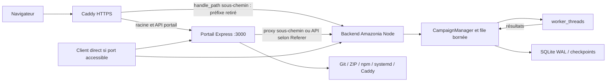

# Complément 1B.4 — Audit croisé Amazonia / portail maître

Audit statique du 8 novembre 2026. Proposition pour revue, pas validation de sécurité ni autorisation de déploiement.

## Périmètre et preuves reproductibles

Les deux dépôts sont accessibles depuis Codex (`git ls-remote … HEAD` réussi). Révisions examinées :

- Amazonia : `db338cfffdc719bb622902834f663920fbe82146` (main, PR #4 incluse).
- Portail : `456199e66814958edc40d5580a0f73744fecc2ac` (main).

Les références `P:Lx` désignent [server.ts du portail à cette révision](https://github.com/antoineacquaviva/atelier-portail-maitre/blob/456199e66814958edc40d5580a0f73744fecc2ac/server.ts). Les références `A:Lx` désignent [server.ts Amazonia](https://github.com/antoineacquaviva/Amazonia/blob/db338cfffdc719bb622902834f663920fbe82146/server.ts). Sources complémentaires : `src/server/{campaignManager,campaignStore,durableStore,workerPool}.ts`, `docs/LONG_CAMPAIGNS.md`, `package.json` Amazonia ; arborescence du portail et `src/components/DocumentationView.tsx` (même révision).

Aucune requête à la production, aucun lancement du serveur du portail, aucune commande sur Oracle. Les Caddyfile, unités systemd, registre `/srv/jeu/tools-registry.json`, pare-feu OCI/hôte, versions Node et éventuel fournisseur d'identité réellement installés n'ont pas été consultés. Les exemples du code ne prouvent pas la configuration active. Aucun mécanisme d'authentification n'est documenté dans la vue Documentation examinée ; cela ne permet pas d'exclure des protections externes.

Le texte initial de 1B.4 et une PR correspondante ne sont pas disponibles dans ce chat ; aucune PR ouverte n'a été renvoyée par `gh pr list --state open`. Ce complément livre l'audit et les modifications proposées, sans choisir ni implémenter silencieusement un système d'identité. Les protections décrites ci-dessous restent à implémenter.

## A. Cartographie des flux observés et cible

Caddy généré : redirection du sous-chemin sans slash, `handle_path` vers le port local, racine vers 3000 (`P:L293–324`). Le proxy Express (`P:L1334–1459`) retire aussi le sous-chemin. Pour les `/api/*` non réservées au portail, il choisit l'outil par présence du sous-chemin dans Referer, puis Amazonia, puis un outil Node actif. Ce choix est une heuristique de routage, jamais une autorisation. Le proxy recopie les en-têtes entrants, dont cookies et Authorization, et ajoute `x-forwarded-prefix`.

Amazonia monte le même routeur sur `/api` et `/:subpath/api` (`A:L222–223`). Il écoute sur `0.0.0.0` (`A:L259–265`), comme le portail (`P:L1475`). Il faut donc traiter les accès directs, les alias de chemin, le chemin Caddy et le proxy interne comme autant de chemins vers la même autorisation backend. Protéger uniquement la page du portail ne protège pas Amazonia.

Les workers et la boucle de campagnes vivent côté serveur, indépendamment du polling HTTP. SQLite valide progression et lots transactionnellement. La fermeture du navigateur ne les arrête pas. Après redémarrage, la reprise est explicite, pas automatique : préserver ce contrat (LONG_CAMPAIGNS).

## B. Matrice des risques

Gravité = impact potentiel ; exploitabilité publique non démontrée. Aucun scénario offensif exécuté.

| Risque | Gravité | Preuve source et limites | Correction recommandée |
|---|---|---|---|
| Administration portail sans garde applicative | Critique potentielle | `P:L838–842`, routes action L878, déploiement L1033, création L1172, auto-update L1294 ; aucun middleware d'identité préalable. Accessibilité réseau inconnue. | Authentification commune et rôles sur chaque route, refus par défaut ; restreindre ports. |
| Commandes shell issues de requêtes | Critique potentielle | `action` interpolé dans `sudo systemctl` L993 sans liste fermée ; repo, sous-chemin, buildCmd et execStart traversent les chemins de déploiement L1172–1272. | Enum d'actions ; API de commandes à arguments, sans shell ; catalogue de recettes administré hors HTTP ; validation des unités/ports/chemins et interdiction CR/LF dans configurations. |
| Privilèges transversaux | Critique potentielle | Suggestion `opc ALL=(ALL) NOPASSWD: ALL` L259 ; services User=opc L353 ; chown récursif /srv/jeu L101. Présence effective sudoers inconnue. | Utilisateurs séparés par application, données et déployeur séparés ; helper root propriétaire et non modifiable par les applis, actions/unités fermées ; aucun sudo général. |
| Contournement par backend/alias/proxy | Élevée | API Amazonia sans authentification L24–223 ; routes de lecture, exports, création, pause/reprise/arrêt/suppression ; écoute toutes interfaces. | Même garde avant tous les montages API ; ne faire confiance ni au localhost ni aux en-têtes entrants ; lier sur loopback et filtrer en complément. |
| Écrasement de la protection Caddy | Élevée | Caddyfile complet généré L293 puis remplacé L333 ; autoHeal le synchronise au démarrage L790–798. | Inclure l'auth dans la génération ou importer un fragment sécurisé stable, valider avant remplacement atomique ; ne pas dépendre d'une édition manuelle éphémère. |
| Confusion de destination et de credentials | Élevée | Referer.includes et replis L1356–1364 ; copie de req.headers L1390 environ. | Routage explicite par chemin unique ; suppression des en-têtes d'identité client ; transmettre une preuve signée liée à l'audience, jamais redistribuer aveuglément les credentials aux outils. |
| ZIP et arborescences non fiables | Élevée | Extraction unzip L1090/L1241 sans inspection applicative ; rsync L1106 ; copie initiale L1252 ; répertoire sans .git supprimé L194. | Quotas taille/compression/nombre ; rejeter chemins absolus, sorties de racine, liens et fichiers spéciaux ; staging privé mkdtemp ; vérifier realpath et racines avant toute copie/suppression ; ne jamais fusionner une archive dans les données. |
| Intégrité et disponibilité des campagnes | Élevée | Racine relative au cwd dans campaignManager ; base SQLite et WAL/SHM ; reset --hard et déploiement en place. | Racine de données externe explicite, hors checkout, accès exclusif, sauvegarde cohérente et restauration testée ; vérifier plan de fichiers avant activation. |
| Accès aux données entre outils de même origine | Élevée | Même domaine sous-chemins ; proxy transmet cookies ; pas de sessions applicatives constatées. | Les sous-chemins ne sont pas des frontières de sécurité. Une XSS dans un outil peut appeler les autres API de même origine. Isoler les outils non fiables par origine ; cookies hôte HttpOnly/Secure/SameSite, session unique et rôles, CSRF. |
| Fuite de métadonnées et action sur GET | Moyenne | `/api/overview` expose registre/logs/prérequis ; getVmPrerequisites L259–288 peut générer une clé SSH. | Réserver supervision à opérateur ; retirer les effets de bord des GET ; minimiser et expurger les logs. |
| Mauvais runtime ou service statique | Élevée | Détection regex du backend L655–670, Node non épinglé dans unité ; Python statique possible si détection échoue. | Contrat explicite de déploiement Node >=24 et backend obligatoire ; échec bloquant si runtime/backend absent ; test readiness API réel. |
| Disponibilité / saturation | Élevée | JSON portail 100mb L842, commandes execSync bloquantes, calcul unitaire synchrone Amazonia L187–214. Les campagnes ont déjà admission et pool bornés. | Limites corps et débit par identité, budgets de simulation, opérations de déploiement sérialisées hors thread HTTP ; conserver plafonds du pool. |

La suppression d'un outil retire son registre et arrête/désactive son service (`P:L890–903`) ; elle ne supprime pas explicitement son répertoire. Elle reste une opération administrative de disponibilité. Ne pas la confondre avec la suppression logique d'une campagne Amazonia, durable via tombstone.

## C. Frontière d'autorisation et droits

Proposition simple : un fournisseur d'identité et une session commune au point d'entrée ; aucun deuxième système de comptes Amazonia. Le service d'identité délivre une assertion courte signée destinée au backend (issuer, audience, sujet, rôles/scopes, expiration). Chaque backend valide la signature et ces contraintes avant d'accéder à ses routes. La preuve doit être transmise par un canal protégé ; le backend doit rejeter les en-têtes d'identité bruts et toute absence de preuve, même en accès local. Ne pas distribuer une clé privée de signature à chaque outil : vérification par clé publique, rotation et révocation documentées.

Le proxy supprime toute assertion fournie librement par le navigateur puis injecte celle établie par la session. Aucun secret ne doit être livré au JavaScript. Caddy doit appliquer l'auth aussi bien aux branches handle_path qu'au portail racine. Le portail doit lui-même autoriser ses opérations administratives. La protection backend reste nécessaire si l'entrée est contournée. Configurer précisément les proxies de confiance ; pas de `trust proxy` universel.

Sans configuration d'identité fiable : refuser les API métier (503 configuration indisponible, puis 401/403 selon identité/droits). Ne pas activer de mode permissif implicite en développement ou en production. Seule une sonde minimale sans informations sensibles peut être publique. Le health actuel est détaillé et doit rester opérateur ou être scindé. Les codes de refus ne doivent pas provoquer un repli navigateur ou statique.

| Classe | Actions | Autorisation cible |
|---|---|---|
| Public | Ressources de connexion, sonde minimale éventuelle | Aucun état de campagne ni commande ; public à confirmer |
| Lecture autorisée | Campagnes, détail, exports, résultats | Session vérifiée + rôle lecteur ; décider explicitement si tous les lecteurs partagent toutes les campagnes |
| Calcul / contrôle | Créer, simuler, pause, reprise, arrêt | Opérateur + limites de ressources ; pas de contrôle par simple possession d'un ID |
| Suppression | DELETE campagne | Droit explicite de suppression et journal d'audit |
| Administration système | Outil, ZIP/Git, diagnostic-réparation, self-update, Caddy/systemd | Administrateur distinct ; validation serveur puis helper limité ; aucune commande arbitraire |

Pour les sessions navigateur : vérifier CSRF sur les mutations, notamment si des cookies sont acceptés directement par les backends ; SameSite et Origin sont des défenses complémentaires, pas une autorisation. CORS ne protège pas une API contre un client direct. Path du cookie ne protège pas contre un script du même domaine. Éviter un cookie Domain large ; une session centrale peut fournir des sessions par origine sans multiplier les comptes. La durée des campagnes ne dépend ni du TTL des cookies ni de la présence du navigateur.

## D. Modifications nécessaires, non appliquées

### Amazonia (suite de 1B.4)

1. Middleware d'autorisation central avant toutes les routes API et leurs alias ; validation d'assertion selon contrat commun à faire approuver ; tests de refus par défaut, expiration, audience, signature, rôles et accès directs.
2. Contrat de routage canonique explicite (par exemple `/amazonia/api/` côté navigateur), éviter l'alias arbitraire si inutile ; vérifier la cohérence client et Caddy sans dépendre de Referer.
3. Configuration de racine durable absolue et hôte d'écoute ; garder le port imposé, ne pas se rabattre sur le port du portail. Le main actuel n'a plus le repli de port de l'ancien checkout.
4. Manifest de déploiement backend Node 24 obligatoire ; readiness HTTP et SQLite, arrêt propre/checkpoint, aucune transformation de source automatique ; droits lecture seule du code et écriture seulement des données.
5. Tests HTTP locaux avec faux fournisseur/signatures de test, variantes de chemins et faux en-têtes, matrice de rôles ; contrôle de ressources de simulation ; préserver les résultats scientifiques existants.

La présente PR ne modifie que ce rapport. Ces corrections ne sont pas déclarées implémentées. Le périmètre initial manquant de 1B.4 doit être réconcilié avant implementation.

### Portail (PR séparée, validation propriétaire obligatoire)

1. Garde d'authentification et d'autorisation sur toutes les routes ; séparer lecture, contrôle et administration ; journal sans secrets. Déplacer la génération de clé hors GET.
2. Supprimer shell libre, limiter les champs/commandes, recettes déploiement et helper privilégié. Interdire les collisions de ports, sous-chemins, unités et répertoires (notamment racine et chemins réservés).
3. Retirer le routage Referer et les replis vers un outil arbitraire ; définir le contrat d'assertion/audience, filtrer headers et cookies vers chaque outil.
4. Génération Caddy conservant la protection commune, validation avant activation et sauvegarde de la configuration ; supprimer réparation automatique intrusive au démarrage.
5. Manifest explicite Node/SQLite ; contrôler Node 24 avec chemin absolu ; ne jamais rétrograder un backend en site statique ; supprimer patchs regex du source et réécriture automatique des workers.
6. Staging ZIP sûr, releases immuables vérifiées, données externes, sauvegardes et rollback coordonnés. Ne pas publier automatiquement le contenu d'un ZIP sur GitHub (le flux actuel fait git add -A, commit, push).

Aucune de ces modifications ne doit être appliquée au portail pendant cette mission.

## E. Déploiement coordonné proposé (non exécuté)

1. **Inventorier en lecture seule après autorisation** les ports, unités, Node réellement utilisé par systemd, registre et chemins réels, règles OCI/pare-feu, configuration Caddy complète, auth existante et mécanismes de sauvegarde. Déterminer qui peut lire/modifier/supprimer les campagnes. Ne pas déduire ces éléments des DEFAULT_TOOLS.
2. **Fermer la surface administrative puis sécuriser le portail**, via intervention distincte approuvée : filtrage d'entrée, identité commune, helper limité et générateur Caddy corrigé ensemble. Bloquer auto-update/autoHeal tant que la protection n'est pas persistante. Tester sur copie isolée ; pas de « réparation » publique pour vérifier la sécurité.
3. **Préparer Oracle**, avec accord explicite : compte Amazonia dédié sans sudo, Node 24 absolu vérifié dans le contexte systemd, stockage externe réservé et sauvegarde/restauration contrôlée, quotas et permissions. Ne pas copier une base active en ignorant WAL ; utiliser l'API de sauvegarde SQLite ou une procédure à l'arrêt cohérente.
4. **Préparer et tester la release Amazonia** avec autorisation backend refusant par défaut ; staging sur données temporaires, puis build et tests historiques. Readiness doit confirmer API réelle + SQLite, pas seulement index.html ou port ouvert.
5. **Activer de façon coordonnée** la preuve d'identité, les routes Caddy/proxy et Amazonia, sans fenêtre permissive ; vérifier refus anonymes sur chaque chemin et succès selon rôles. Les tests de production seront non destructifs et explicitement autorisés ; toute création/suppression utilise seulement un environnement de recette.
6. **Suivi et retour arrière** : sauvegarder révision code, registre, unité et Caddy validés ; conserver une release précédente compatible avec le schéma SQLite. Ne jamais revenir au serveur JSON ancien sur la base durable ; restaurer une sauvegarde sur un autre chemin et vérifier avant bascule. La session navigateur ne doit pas commander la vie du service ; les campagnes interrompues attendent une reprise explicite.

### Conséquences précises du déploiement actuel

- Git : clone HTTPS puis SSH ; mise à jour `fetch origin branche` + `reset --hard origin/branche`, repli FETCH_HEAD (`P:L178–235`). Cela écrase les modifications suivies et patchs locaux. Cela ne garantit pas la protection des données non suivies : collisions avec nouveaux fichiers suivis possibles ; si .git absent, `rm -rf vmPath`. Ne pas stocker la seule copie de données sous cette racine.
- ZIP de mise à jour : `rsync --delete` exclut notamment `.git`, `node_modules`, `dist`, `data`, `outputs` (`P:L1106`). Cette exclusion est utile mais n'est pas une sauvegarde ni une garantie globale : la création initiale copie l'archive sans les mêmes exclusions, un stockage ailleurs peut être remplacé, et git add -A peut prendre des fichiers non ignorés. Rejeter explicitement les archives contenant des données de campagne.
- `WorkingDirectory=tool.vmPath`, `PORT`, production, PATH générique et User=opc sont générés (`P:L347–367`). Amazonia résout actuellement `data/campaigns` depuis ce cwd ; changer vmPath peut afficher une base vide et laisser l'ancienne ailleurs. Aucun EnvironmentFile pour une future identité/racine de données n'est généré.
- Détection actuelle : package.json entraîne le chemin Node, src suffit à déclencher Vite ; détection regex dans server.ts choisit le backend. Amazonia actuel est reconnu (`apiRouter`, `express()`), et le repli Python après échec est interdit quand useNodeBackend est vrai (`P:L747`). Cette protection existe, mais dépend d'une heuristique fragile ; ne pas prétendre qu'Amazonia actuel est forcément servi statiquement.
- Node : l'unité lance tsx par bash, sans version Node épinglée ; `engines >=24` Amazonia n'impose pas à lui seul cette version à systemd. Le bundling des workers et la modification de leurs références changent le code déployé hors Git ; valider plutôt une chaîne build/worker appartenant à Amazonia.
- Ancien dist restauré seul après erreur build : ne constitue pas un retour arrière backend/SQLite cohérent. `fuser -k` sur le port (`P:L718`) peut arrêter un autre service en cas de collision ; refuser la collision avant arrêt.

## Validation de ce livrable et limites

Lecture statique uniquement. Commandes de contrôle : accès Git aux deux HEAD, lecture des fichiers aux révisions indiquées, `gh pr list --state open`, `git diff --check`, comparaison des arbres suivis avec origin/main et contrôle du périmètre du commit. Aucun test dynamique ni suite scientifique exécutée : ce changement est exclusivement documentaire et ne démarre aucune campagne. Le checkout initial et son `data/` préexistant restent intacts ; le travail est isolé dans un autre worktree.

Reste à obtenir : cadrage initial 1B.4, choix du fournisseur d'identité et politique de rôles, preuves de configuration Oracle après autorisation. Aucun secret, jeton ni payload d'exploitation n'est inclus. Fusion, modification du portail et toute intervention d'infrastructure attendent la revue de ChatGPT et l'autorisation explicite du propriétaire.
